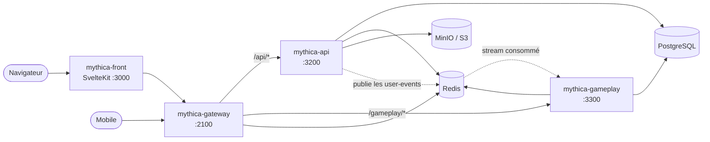
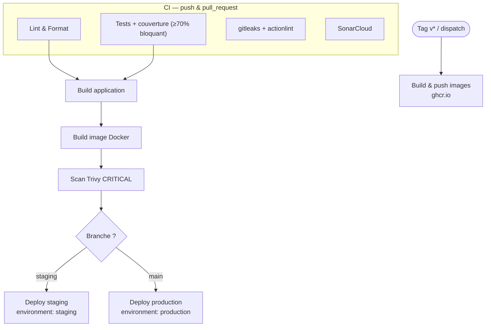

# Architecture

## Architecture applicative

Microservices derrière un **gateway** unique (point d'entrée, terminaison CORS,
résolution de session, injection d'identité, métriques).

**Choix : gateway en façade.** Centraliser l'authentification (validation de
session Redis) et l'injection d'identité (`x-user-id`, `x-user-role`) au gateway
évite de dupliquer cette logique dans chaque service et permet de faire confiance
aux en-têtes internes (le gateway retire tout en-tête d'identité entrant —
anti-spoofing). C'est aussi le point naturel d'instrumentation (métriques) et de
terminaison CORS.

## Pipeline CI/CD

- **Jobs parallèles** : lint, tests, secrets, sonar tournent en parallèle.
- **Jobs séquentiels** (`needs:`) : build → docker → trivy → deploy.
- **Cache** : store Bun mis en cache (clé sur `bun.lock`).
- **Artefacts** : rapports de couverture, Trivy et gitleaks archivés.

## Déploiement & environnements

| Environnement | Déclencheur | Approbation |
|---------------|-------------|-------------|
| `staging` | push sur `staging` | automatique |
| `production` | push sur `main` / tag `v*` / dispatch | manuelle (required reviewers) |

Le workflow [`release.yml`](../.github/workflows/release.yml) publie les images
sur **ghcr.io** (`ghcr.io/tengram-labs/mythica-<service>`), servant de cible CD
même sans serveur. Le déploiement réel passe par Dokploy (webhook).

## Stratégie de rollback

1. **Images taguées** : chaque release pousse un tag immuable (`type=sha` + `v*`).
   Pour revenir en arrière : redéployer le tag précédent
   (`ghcr.io/.../mythica-api:<sha-précédent>`).
2. **Base de données** : les migrations Prisma sont versionnées
   (`prisma/migrations`). Un rollback applicatif sans rollback de schéma reste
   possible tant que les migrations sont additives (compatibilité ascendante).
3. **Git** : `git revert <commit>` sur `main` redéclenche le pipeline et
   reconstruit une image saine. Pas de `force push` sur les branches protégées.

Procédure type : identifier le dernier tag sain → redéployer ce tag via le
webhook Dokploy (ou `docker pull` + `up`) → vérifier `/health` → si nécessaire,
`prisma migrate resolve` pour aligner l'état des migrations.
